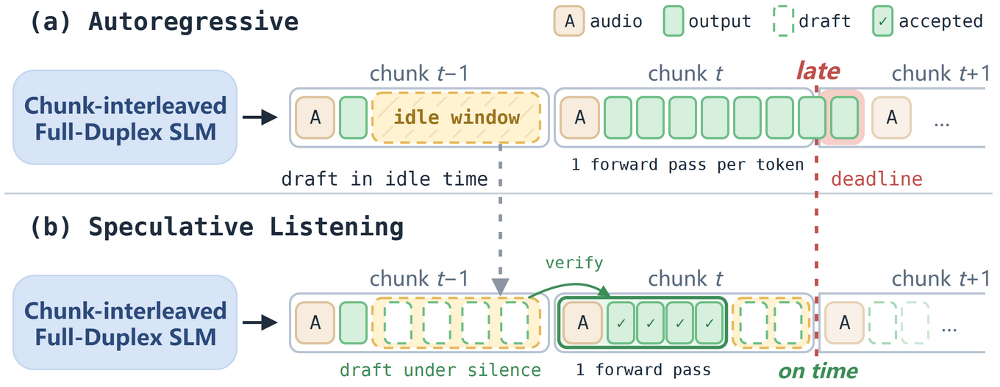
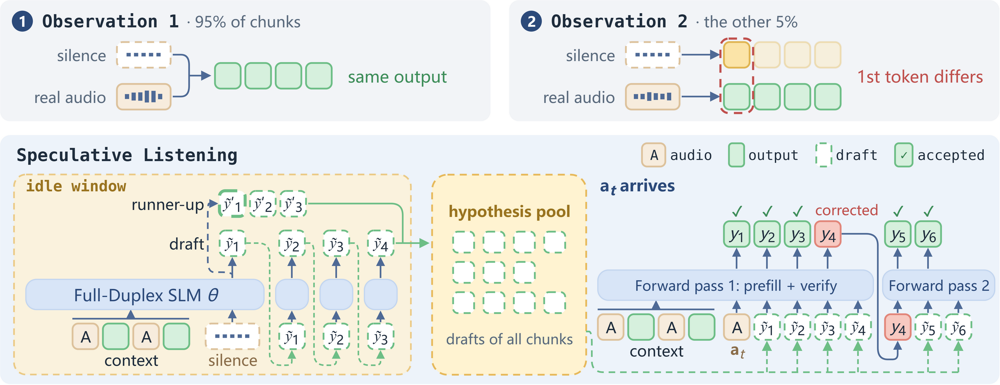

<a name="readme-top"></a>

<div align="center">
  <h1 align="center">Decode Before You Hear: Speculative Listening for Chunk-Interleaved Full-Duplex Speech Language Models</h1>
</div>
<div align="center">
  <a href="https://arxiv.org/abs/2611.06982"></a>
  <a href="https://huggingface.co/papers/2611.06982"></a>
  <a href="./LICENSE"></a>
</div>

---

**Speculative Listening** lets a chunk-interleaved full-duplex speech language model decode the next time chunk before its audio arrives. It is training-free, runs inside the model's released runtime and keeps greedy outputs identical to autoregressive decoding. **TickTock-Bench** measures how such a model decodes each chunk against the chunk deadline. This repository holds both, with the replay drivers for four models, the session manifests and builder, and the scripts behind every table of the paper [*Decode Before You Hear*](https://arxiv.org/abs/2611.06982).



### 🪐 Key Features <span id="key-features"></span>

👂 **Speculative Listening** While a listen chunk waits for audio, the model drafts the next chunk as if that audio were silence. The chunk's own audio prefill verifies the draft, so a correct draft costs no extra forward pass. A runner-up branch at the first token and a hypothesis pool across chunks keep every draft of the session available.

⏱️ **TickTock-Bench** Eight tasks of speech reasoning, conversational dynamics and agentic tool calls, 760 sessions, four chunk-interleaved models through their own runtimes. It reports latency per 1 s chunk by chunk type, maximum lag behind real time, response onset and tool-call latency, and the acceptance of the silence-hypothesis draft.

🧩 **Drop-in speculator** One `Speculator` class sits inside a runtime's decoding loop and serves autoregressive decoding, prompt lookup decoding, Token Recycling, lookahead decoding and Speculative Listening through the same two calls. A new model is a thin adapter; a new method is a drafting policy.

## 🔥 News <span id="news"></span>

<div style="max-height: 240px; overflow-y: auto;">

* **[2026.11]** Paper released on [arXiv](https://arxiv.org/abs/2611.06982); code and TickTock-Bench released.

</div>

## 📑 Table of Contents <span id="table-of-contents"></span>

* [🚀 Quick Start](#quick-start)
    * [1. Installation](#installation)
    * [2. Models and Paths](#models)
    * [3. Sessions](#sessions)
    * [4. Running a Replay](#replay)
* [⏱️ TickTock-Bench](#ticktock-bench)
* [🔁 Reproducing the Paper](#reproduction)
* [✨ How It Works](#how-it-works)
* [📊 Results](#results)
* [🌱 Acknowledgements](#acknowledgements)
* [📚 Citation](#citation)

## 🚀 Quick Start <span id="quick-start"></span>

### 1. Installation <span id="installation"></span>

Each model is replayed inside the Python environment of its released runtime: one environment per runtime
family, described in `envs/`. The package itself needs only numpy, scipy, PyYAML and soundfile and installs
into each of them.

```bash
git clone https://github.com/petrichor20211/Speculative-Listening.git
cd Speculative-Listening
pip install -e .                 # into each environment below and into the python3 that launches scripts/
pip install -e .[sessions]       # adds the session builder's dependencies (datasets, huggingface_hub)

# Streaming SLM            -> envs/duplex.yml
# Gander, Realtime-Venus   -> envs/realtime-venus.yml   (plus the requirements of the two runtimes)
# LWS                      -> envs/lws.md               (the released demo's own virtual environment)
conda env create -f envs/duplex.yml
conda env create -f envs/realtime-venus.yml
```

The unit test runs every method on a toy model on CPU and checks that its tokens equal autoregressive decoding:

```bash
pip install -e .[test] && pytest tests
```

### 2. Models and Paths <span id="models"></span>

One local file names every location: model weights, runtime repositories, session audio, outputs and the
three interpreters. Copy the example and fill it in; git ignores the copy.

```bash
cp config/eval/local.example.yaml config/eval/local.yaml
```

```yaml
# Streaming SLM (weights released separately)
duplex_repo: /path/to/Duplex
slm_checkpoint: /path/to/streaming-slm.ckpt
slm_export: /path/to/streaming_slm_export

# MiniCPM-o-based targets, each through its released runtime
venus_model: /path/to/Realtime-Venus/Realtime-Venus-Audio
venus_repo: /path/to/Realtime-Venus
gander_thinker: /path/to/Gander/thinker
gander_repo: /path/to/Omni-Interaction-Agent/minicpm_ft
lws_repo: /path/to/lws_demo
lws_assets: /path/to/lws-triplex-demo
minicpmo_base: /path/to/MiniCPM-o-4_5

# Data and outputs
fdb_data: /path/to/Full-Duplex-Bench
sessions: /path/to/sessions
outputs: /path/to/outputs

# Interpreters
python_duplex: /path/to/envs/duplex/bin/python
python_venus: /path/to/envs/realtime-venus/bin/python
python_lws: /path/to/lws_demo/.venv/bin/python
```

An environment variable `SPECLISTEN_<KEY>` overrides a key.

### 3. Sessions <span id="sessions"></span>

> [!TIP]
> `config/eval/sessions/` holds the manifests of the paper's 760 sessions: sample ids, order and metadata.
> The builder fetches the audio from the public releases of the source benchmarks and assembles each session.

```bash
# question-answering sets, downloaded from Hugging Face
python -m speclisten.bench.sessions --task webq llamaq triviaqa alpaca bba
# Full-Duplex-Bench v1 / v1.5 / v3, from your copy of the benchmark at fdb_data
python -m speclisten.bench.sessions --task fdbv1 fdbv15 fdbv3
```

Sources, recipes and licences: [docs/DATA.md](docs/DATA.md).

### 4. Running a Replay <span id="replay"></span>

One job replays one session set through one model with a list of methods and writes one JSON line per chunk
and method. It runs the Thinker alone and times it end to end on one GPU: from the arrival of a chunk's
audio to the end of the chunk's output, with the audio encoder, the runtime's own overheads and any drafting
past the idle window inside the measurement.

```bash
# scripts/evaluate/run.sh <target> <gpu> <shard i/n> <run> <sessions.jsonl> <methods> [replay args...]
scripts/evaluate/run.sh gander 0 0/1 gander_llamaq config/eval/sessions/llamaq.jsonl ar,after_audio_lookup,self_silence_h_b
```

Targets: `slm`, `gander`, `venus`, `lws`. Methods:

| name | method |
|---|---|
| `ar` | autoregressive decoding |
| `after_audio_lookup` | prompt lookup decoding (PLD) |
| `after_audio_recycle` | Token Recycling, chain form |
| `after_audio_lookahead` | lookahead decoding, chain form (W = 7, N = 5) |
| `self_silence` | silence-hypothesis draft in the idle window |
| `self_silence_h` | + hypothesis pool |
| `self_silence_h_b` | + runner-up first-token branch (**Speculative Listening**) |
| `self_silence_u` | the oracle: an unbudgeted draft, then the chunk decoded again with the real audio |

Statistics from the records:

```bash
python -m speclisten.bench.report speedup --run OUT/gander_llamaq --method self_silence_h_b --kind S
python -m speclisten.bench.report acceptance --run OUT/gander_oracle_llamaq
```

## ⏱️ TickTock-Bench <span id="ticktock-bench"></span>

TickTock-Bench scores how a chunk-interleaved full-duplex model decodes **each 1 s chunk against the chunk
deadline**: fixed session sets, one replay protocol, one set of metrics, every decoding method run through the
model's own released runtime on the same hardware. It scores any method that changes how a chunk is decoded.
The methods are lossless, so it measures latency and leaves task accuracy to the model's own evaluation.

| group | task | source | sessions |
|---|---|---|---|
| speech reasoning | Web Questions, Llama Questions, TriviaQA | OpenAudioBench | 100 each |
| | AlpacaEval | VoiceBench | 100 |
| | Big Bench Audio | Artificial Analysis | 60 |
| conversational dynamics | Full-Duplex-Bench v1, v1.5 | FDB | 100 each |
| agentic | Full-Duplex-Bench v3 (tool calls) | FDB | 100 |

- **Protocol.** The user's audio is replayed one chunk at a time. The runtime prefills the chunk and decodes
  its output with its own rules, which makes the chunk a listen, speak or tool-call chunk. Greedy decoding,
  batch size 1, bfloat16, one GPU per job; wall clock from the arrival of the chunk's audio to the end of the
  Thinker's output.
- **Metrics.** Post-audio latency and speedup by chunk type, #MAT (output tokens per forward pass), deadline
  miss rate, maximum lag behind real time, response onset and tool-call latency, acceptance rate of the
  silence-hypothesis draft.
- **Models and methods.** Streaming SLM, Gander, Realtime-Venus and LWS; autoregressive decoding, prompt
  lookup decoding, Token Recycling, lookahead decoding and Speculative Listening, named as in the table under
  [Running a Replay](#replay).
- **Leaderboard.** [docs/LEADERBOARD.md](docs/LEADERBOARD.md) holds the speedup and user-perceived-latency
  tables of the four models and says how to add a row.

The protocol, the metrics, the record format and how to add a model or a method are in
[docs/BENCH.md](docs/BENCH.md); sessions, sources and licences in [docs/DATA.md](docs/DATA.md).

## 🔁 Reproducing the Paper <span id="reproduction"></span>

Every number of the paper comes from the runs listed under `scripts/evaluate/jobs/` and one analysis script.

1. **Environments.** One per runtime family: `envs/duplex.yml` (Streaming SLM), `envs/realtime-venus.yml`
   (Gander, Realtime-Venus), `envs/lws.md` (LWS). `pip install -e .` into each of them and into the `python3`
   that runs `scripts/evaluate/`.
2. **Models and paths.** Download the public releases of Gander, Realtime-Venus, LWS with its demo runtime
   and MiniCPM-o 4.5, and the Streaming SLM weights. Fill `config/eval/local.yaml` as in
   [Models and Paths](#models). The Streaming SLM's weights are released separately; its model code comes from
   its training repository, `duplex_repo`.
3. **Sessions.** Build the 760 sessions from the public sources, see [Sessions](#sessions).
4. **Runs.** The job files list every run of the paper: the main table (4 models x 8 tasks x 5 methods), the
   ablation, the speculative-sampling runs and the oracle probe. A queue lane takes the next unclaimed job from
   a file and runs it; start one lane per otherwise idle A100 80 GB.

   ```bash
   for g in 0 1 2 3; do scripts/evaluate/queue.sh scripts/evaluate/jobs/main_table.txt $g lane$g & done; wait
   scripts/evaluate/queue.sh scripts/evaluate/jobs/ablation.txt 0 abl &
   scripts/evaluate/queue.sh scripts/evaluate/jobs/sampling.txt 1 sampling &
   scripts/evaluate/queue.sh scripts/evaluate/jobs/oracle.txt 2 oracle &
   scripts/evaluate/concurrency.sh 3          # multi-session serving
   ```

   A lane records each finished shard and retries a failed one once, so a restarted lane continues with the
   shards still open.
5. **Tables.** One command computes every table from the run directories: the main table and #MAT (Table 2),
   the maximum lag, the chunk profile, the ablation, the user-perceived latencies (Table 5), the forward passes
   by output length, the sampling results, the acceptance rates and the concurrency results.

   ```bash
   python -m speclisten.bench.analyses /path/to/outputs results/     # -> results/analyses.txt, analyses.json
   ```

6. **Response quality.** The AlpacaEval responses of AR and Speculative Listening, scored with VoiceBench's
   open-ended rubric once per model. The judge reads the model's tokenizer through `transformers` and calls
   DeepSeek with the key in `DEEPSEEK_API_KEY`.

   ```bash
   DEEPSEEK_API_KEY=... python -m speclisten.bench.judge --target gander --run OUT/gander_alpaca \
       --sessions config/eval/sessions/alpaca.jsonl --cache OUT/judge_cache.jsonl
   ```

One cell of a table, one model on one task, is one line of `main_table.txt` followed by
`python -m speclisten.bench.report speedup --run OUT/<model>_<task> --method self_silence_h_b --kind S`.
Latencies are wall clock on one A100 80 GB; on other hardware the speedups carry over more closely than the
latencies.

## ✨ How It Works <span id="how-it-works"></span>



A chunk-interleaved full-duplex model listens and speaks in fixed time chunks, and each chunk has to be
processed before the next one arrives. In a listen chunk the model waits for audio and the GPU has most of
the second free; in a speak or tool-call chunk it generates tokens one by one, and this is where responses
and tool calls wait. Speculative Listening spends the free time of the listen chunk on the next chunk, which
means decoding it before its audio arrives, under an assumed input.

- **Two observations.** With silence as the assumed input, the output equals the output under the real audio
  in 95.3% of chunks across the four models, and 88% of the differences begin at the first output token.
- **Silence-hypothesis draft.** In the idle time, the model decodes the next chunk as if the incoming audio
  were silence. The draft rides in the chunk's audio prefill forward pass, where it is verified token by
  token; an accepted draft costs no further pass.
- **Runner-up branch.** Because differences start at the first token, a second draft continues from the
  runner-up first token.
- **Hypothesis pool.** Every draft of the session is kept; after a rejection, the continuation is proposed
  from the pool by n-gram lookup before the model falls back to one token per pass.
- **Lossless.** Verification compares tokens inside the runtime's own loop, so greedy outputs equal
  autoregressive decoding; speculative sampling covers the sampling case.

## 📊 Results <span id="results"></span>

Table 2 of the paper: speedup over autoregressive decoding in mean post-audio latency of speak chunks (FDB v3:
tool-call chunks for the two models that issue tool calls), wall clock, one A100 80 GB. The baselines and the
user-perceived latencies are in [docs/LEADERBOARD.md](docs/LEADERBOARD.md).

| Model | Method | Web Q. | Llama Q. | TriviaQA | AlpacaEval | BBA | FDB v1 | FDB v1.5 | FDB v3 | Avg. |
|---|---|---|---|---|---|---|---|---|---|---|
| Streaming SLM | Speculative Listening | 2.80 | 2.87 | 3.04 | 2.75 | 2.67 | 2.62 | 2.57 | 23.41 | 2.76 |
| Gander | Speculative Listening | 2.82 | 3.00 | 3.26 | 2.18 | 2.47 | 2.18 | 2.27 | 3.45 | 2.60 |
| Realtime-Venus | Speculative Listening | 2.75 | 2.81 | 2.73 | 2.85 | 2.59 | 2.57 | 2.54 | 2.41 | 2.69 |
| LWS | Speculative Listening | 2.43 | 2.95 | 2.74 | 2.24 | 3.46 | 2.37 | 2.55 | 1.60 | 2.68 |

Across the four models, Speculative Listening speeds up speak chunks by 2.6-2.8x on average and tool-call
chunks by up to 23.4x, reduces the decoding delay before a response starts by 73% on average (to 74-241 ms),
and reduces the maximum lag behind real time by 94.4%.

## 🌱 **Acknowledgements** <span id="acknowledgements"></span>

[](https://arxiv.org/abs/2609.08977)
[](https://arxiv.org/abs/2609.13814)
[](https://arxiv.org/abs/2606.07547)
[](https://github.com/OpenBMB/MiniCPM-o)
[](https://huggingface.co/datasets/baichuan-inc/OpenAudioBench)
[](https://huggingface.co/datasets/hlt-lab/voicebench)
[](https://huggingface.co/datasets/ArtificialAnalysis/big_bench_audio)
[](https://github.com/DanielLin94144/Full-Duplex-Bench)

The replay drivers run the released runtimes of Gander, Realtime-Venus and LWS as they are; the Streaming SLM
is trained from the Qwen2.5-Omni-7B Thinker. The baselines follow prompt lookup decoding (Saxena, 2023), Token
Recycling (Luo et al., 2025) and lookahead decoding (Fu et al., 2024) in chain form; the protocol and #MAT
follow Spec-Bench (Xia et al., 2024); the response-quality judge uses VoiceBench's open-ended rubric. The
sessions are built from the public releases of the source benchmarks, whose licences are listed in
[docs/DATA.md](docs/DATA.md). This project is licensed under the **Apache License 2.0**, see [LICENSE](./LICENSE).

## 📚 **Citation** <span id="citation"></span>

```bibtex
@misc{bian2026decodehearspeculativelistening,
      title={Decode Before You Hear: Speculative Listening for Chunk-Interleaved Full-Duplex Speech Language Models}, 
      author={Yutong Bian and Yanglin Zhang and Yuxiang Wang and Luoyuan Zhang and Rongshen He and Zihao Wang and Junwen Qiu and Jiaqi Li and Zhizheng Wu},
      year={2026},
      eprint={2611.06982},
      archivePrefix={arXiv},
      primaryClass={cs.SD},
      url={https://arxiv.org/abs/2611.06982}, 
}
```

---

<div align="center">
  <a href="https://github.com/petrichor20211/Speculative-Listening"></a>
  <a href="https://github.com/petrichor20211/Speculative-Listening/issues"></a>
</div>
